# Rufus Bank App Images Optimization

Repositorio de buenas prácticas para servir las imágenes de campañas (pop-ups) de una app bancaria con **Amazon S3 + AWS Lambda + Amazon CloudFront**, con toda la infraestructura en **AWS CDK (Python)**, un **portal React** que muestra de dónde viene cada imagen y un **modelo de costos** para 10 M, 60 M y 100 M solicitudes al mes, sin y con cada optimización.

Rufus Bank es un banco ficticio. Sus 40 pop-ups de demo (Telefonía Rufus, Créditos Rufus, CryptoMonedas Rufus y Rufus Bolsillos Rentables) viven en `assets/images/original`.

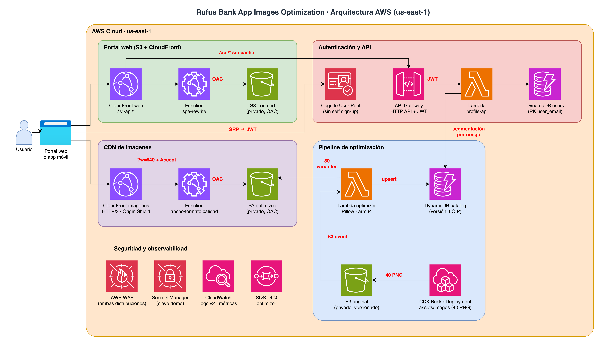

## TL;DR

| Qué | Resultado medido en este repo |
|---|---|
| Peso de un pop-up | PNG original promedio **1,66 MB** → AVIF 640w **32 KB** (−98,1%), WebP 41 KB, JPEG 72 KB |
| Dónde está la plata | En la factura de imágenes manda la **transferencia de datos**, no las solicitudes: un cache HIT también se cobra |
| 60 M solicitudes al mes | **85,8 TB → 1,5 TB**. Pay-as-you-go Suramérica de **US$ 8.906 a US$ 295** al mes |
| Planes flat-rate | Sin optimizar solo cabe en **Premium L3 (US$ 2.250)**. Optimizado cabe en **Business (US$ 200)** |
| Caché en el dispositivo | Al recargar el portal: **20 de 20 imágenes desde el teléfono, 0 solicitudes, 0 bytes** |
| Seguridad | 3 buckets S3 privados (OAC), APIs solo por API Gateway, WAF en las 2 distribuciones, CSP estricta |
| Validación | **28 tests unitarios** y **79/79 validaciones E2E** contra AWS |

## Contenido

1. [El caso](#el-caso)
2. [Arquitectura](#arquitectura)
3. [Cómo viaja una imagen](#cómo-viaja-una-imagen)
4. [Buenas prácticas implementadas](#buenas-prácticas-implementadas)
5. [El portal de demostración](#el-portal-de-demostración)
6. [Costos: 10 M, 60 M y 100 M solicitudes, sin y con optimizaciones](#costos-10-m-60-m-y-100-m-solicitudes-sin-y-con-optimizaciones)
7. [Planes flat-rate: Business, Premium y Enterprise](#planes-flat-rate-business-premium-y-enterprise)
8. [Costos que no se ven a primera vista](#costos-que-no-se-ven-a-primera-vista)
9. [Despliegue paso a paso](#despliegue-paso-a-paso)
10. [Validación E2E](#validación-e2e)
11. [Medir antes de decidir](#medir-antes-de-decidir)
12. [Decisiones y supuestos](#decisiones-y-supuestos)
13. [Estructura del proyecto](#estructura-del-proyecto)
14. [Referencias](#referencias)

## El caso

Cuando el usuario abre la app aparecen pop-ups de campañas comerciales. Hoy esas imágenes se sirven desde una plataforma de marketing de terceros y se quiere validar si conviene exponerlas con **S3 + CloudFront**, si los planes **Business** o **Enterprise** de CloudFront tienen sentido y qué costos no se están viendo. El volumen estimado es de **60 millones de imágenes al mes con un peso medio de 1,5 MB**.

La cuenta rápida explica todo el repositorio:

```
transferencia mensual = solicitudes × bytes por imagen × fracción que el teléfono vuelve a descargar
60.000.000 × 1,5 MB = 85,8 TB al mes  (más que los 50 TB del plan Business)
```

Las tres palancas, en el orden en que se deben mover:

1. **Menos bytes por imagen**: ancho correcto para cada pantalla y formatos modernos (AVIF, WebP).
2. **Menos descargas**: la imagen se queda en el teléfono (Cache-Control, URLs estables y versionadas).
3. **Menor precio por byte**: plan flat-rate, Savings Bundle o descuentos, decidido después de optimizar.

## Arquitectura

Tres stacks de CDK (`infrastructure/cdk/stacks`), todos con el prefijo `cloudfront-images-optimization`:

| Stack | Recursos |
|---|---|
| `cloudfront-images-optimization-images-dev` | S3 **original** y S3 **optimized** (privados), Lambda optimizadora (Python 3.14, arm64, Pillow con AVIF), tabla DynamoDB `catalog`, BucketDeployment de las 40 imágenes, CloudFront de imágenes con CloudFront Function, cache policy, response headers policy, Origin Shield, WAF, logs v2, métricas adicionales y dashboard |
| `cloudfront-images-optimization-backend-dev` | Cognito User Pool (sin self sign-up), 3 usuarios demo con contraseña permanente, tabla DynamoDB `users` (PK `user_email`), Secrets Manager, Lambda `profile-api`, API Gateway HTTP API con JWT authorizer |
| `cloudfront-images-optimization-frontend-dev` | S3 **frontend** (privado), CloudFront web con OAC, `/api/*` hacia API Gateway, CloudFront Function para rutas SPA, headers de seguridad (CSP, HSTS), WAF |

Nombres de los buckets: `cloudfront-images-optimization-{original|optimized|frontend}-dev-<AccountId>`.

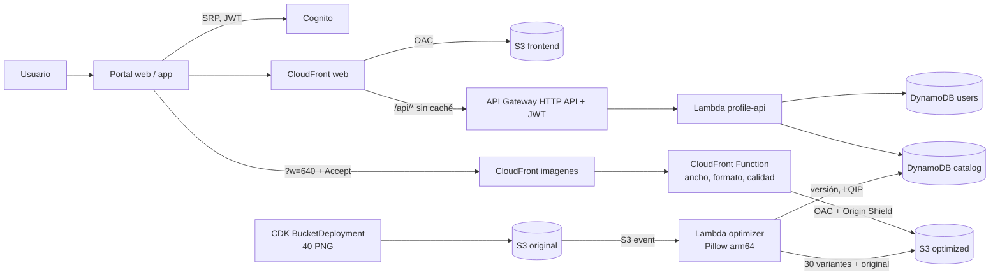

El diagrama editable está en `assets/architecture.drawio` (y `assets/cache-layers.drawio`).

## Cómo viaja una imagen

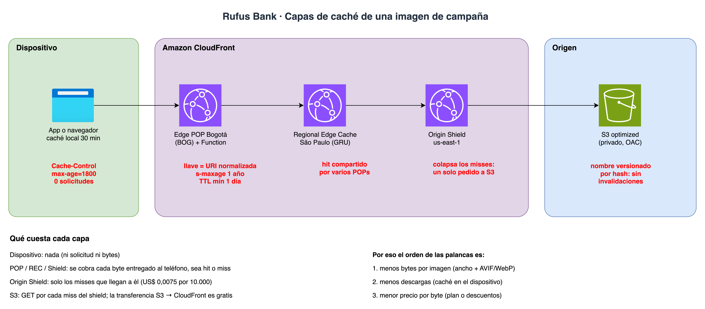

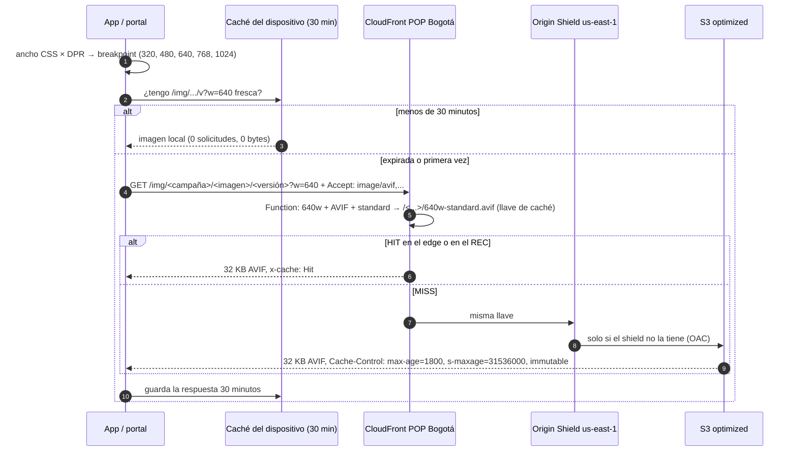

Y así se generan las variantes cuando marketing sube un original:

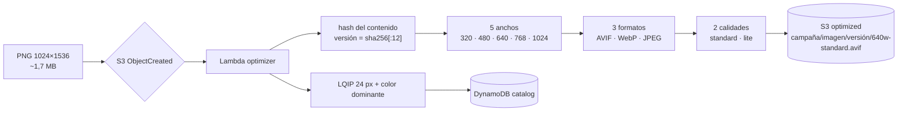

## Buenas prácticas implementadas

Cada punto dice qué se hizo, por qué y dónde está en el código.

### A. Menos bytes por imagen (palanca 1)

| # | Práctica | Por qué | Dónde |
|---|---|---|---|
| 1 | Variantes pre-generadas por evento S3: 5 anchos × 3 formatos × 2 calidades + el original | Un catálogo curado de campañas no necesita transformar en cada solicitud: se paga una vez por imagen (~5 s de Lambda) | `backend/lambdas/image_optimizer/` |
| 2 | Nunca escalar hacia arriba, LANCZOS, sin EXIF/XMP/GPS | Calidad visual, privacidad y bytes | `optimizer.py` |
| 3 | AVIF > WebP > JPEG elegido en el edge por el header `Accept` | AVIF pesa ~55% menos que JPEG en estas imágenes; los clientes viejos siguen recibiendo JPEG | `cloudfront/image-negotiation.js` |
| 4 | Ancho × DPR normalizado a breakpoints en el cliente y en el edge | Un teléfono recibe la imagen del ancho que dibuja, no la del diseño | `frontend/src/lib/variants.ts` y la Function |
| 5 | Calidad adaptativa: `Save-Data: on` o redes `slow-2g/2g/3g` reciben el tier `lite` | Menos datos móviles cuando el usuario lo pide o la red es lenta | Function + `variants.ts` |
| 6 | LQIP (placeholder de ~300 bytes) y color dominante en el catálogo | La tarjeta se pinta al instante y la imagen real aparece encima | `optimizer.py`, `PopupCard.tsx` |
| 7 | Lazy loading con `IntersectionObserver` | Solo se descarga lo que va a aparecer en pantalla | `frontend/src/lib/hooks.ts` |
| 8 | Medición en el pipeline: métricas EMF (bytes originales vs 640w AVIF, tiempo) | Saber cuánto se ahorra por imagen sin llamadas extra a CloudWatch | `handler.py` |

### B. CloudFront: llave de caché, TTL y headers

| # | Práctica | Por qué | Dónde |
|---|---|---|---|
| 9 | Cache policy con llave **solo URI**: sin headers, cookies ni query strings | Cada variante se guarda una sola vez por edge; el `Accept` crudo nunca entra en la llave | `cdk_images_stack.py` |
| 10 | La CloudFront Function escribe la decisión en la URI (`640w-standard.avif`) y borra el query string | Miles de combinaciones de solicitud colapsan en 30 objetos por imagen (probado: `w=481..640` → una sola llave) | `image-negotiation.js` |
| 11 | Compresión **apagada** para imágenes (`Accept-Encoding` fuera de la llave) | Gzip/Brotli no reducen JPEG/PNG/WebP/AVIF y duplicarían entradas de caché | cache policy + `compress=False` |
| 12 | Compresión **encendida** (Brotli/Gzip) para el portal | HTML, JS y CSS sí se comprimen: el JS de 384 KB viaja en ~117 KB | frontend stack |
| 13 | TTL del edge: `s-maxage` 1 año, TTL mínimo 1 día, default 30 días | Las variantes son inmutables porque la URL lleva la versión | `cdk.json` → `images` |
| 14 | URLs versionadas por hash de contenido (`/img/<campaña>/<imagen>/<versión>`) | Una imagen nueva es una URL nueva: **nunca se invalida** (y no se pagan invalidaciones) | `handler.py`, `profile_api` |
| 15 | Origin Shield en us-east-1 | Los misses de todas las regiones llegan como un solo pedido a S3 (en la demo: 10 de 20 hits vinieron del shield) | `origin_shield_enabled` |
| 16 | HTTP/2 + HTTP/3 e IPv6 | Menos latencia en redes móviles (el comprobante muestra `h3`) | ambas distribuciones |
| 17 | Response headers policy: `Vary: Accept`, CORS `*`, `Timing-Allow-Origin`, **Server-Timing**, `nosniff`, HSTS, sin headers de S3 | El portal (y una app) puede leer hit/miss, POP y capa de cada imagen; los proxies no mezclan formatos | `cdk_images_stack.py` |
| 18 | Allow-list estricta de rutas en la Function: todo lo demás es 404 en el edge | Nada distinto a una variante llega al bucket (sin listados, sin path traversal) | `image-negotiation.js` |
| 19 | Caché de errores 403/404 por 60 s | Una URL inexistente no martilla el origen | `error_responses` |
| 20 | Price Class configurable (`PRICE_CLASS_ALL` en la demo: POP de Bogotá) | Trade-off latencia vs tarifa; ver la sección de costos | `cdk.json` |

### C. Menos descargas: el dispositivo (palanca 2)

| # | Práctica | Por qué | Dónde |
|---|---|---|---|
| 21 | `Cache-Control: public, max-age=1800, s-maxage=31536000, immutable` en cada variante | El teléfono guarda 30 minutos (pedido de la demo); el edge guarda 1 año | metadata S3 desde la Lambda |
| 22 | Caché local del portal con **Cache Storage** y TTL de 30 minutos, limpieza cada 30 s | Al recargar: 0 solicitudes y 0 bytes. Se usa un almacén de archivos del navegador, **no cookies**: una cookie tiene ~4 KB y viaja en cada solicitud, haciendo todo más pesado | `frontend/src/lib/deviceCache.ts` |
| 23 | URLs estables: sin tokens, timestamps ni parámetros aleatorios | CloudFront los ignora (no están en la llave) pero el teléfono no: una URL nueva es otra descarga | `variants.ts` |
| 24 | `Accept` explícito en clientes que no son `` | `fetch()` (y muchas librerías nativas) envía `Accept: */*`: sin declararlo el edge entrega JPEG. Este bug se encontró y corrigió durante la validación en el navegador | `variants.ts` → `imageAcceptHeader()` |
| 25 | Recomendación para las apps móviles | OkHttp trae la caché apagada por defecto, Coil 3 ignora `Cache-Control`, Kingfisher y SDWebImage usan su propia caché de 7 días, iOS URLCache rechaza respuestas mayores al 5% de su disco: configúralas a propósito | ver referencias |

### D. Seguridad (lineamientos de la organización)

| # | Práctica | Dónde |
|---|---|---|
| 26 | **3 buckets S3 privados**: Block Public Access, SSE-S3, solo TLS (y TLS 1.2 mínimo), `BucketOwnerEnforced`, **OAC** (nunca OAI) y **sin S3 static website hosting** | `cdk_images_stack.py`, `cdk_frontend_stack.py` |
| 27 | APIs solo por **API Gateway + Lambda** (HTTP API con JWT authorizer de Cognito), servidas por la misma distribución en `/api/*`. **Cero Lambda Function URLs** | `cdk_backend_stack.py` |
| 28 | Cognito sin self sign-up, SRP (la contraseña no viaja), usuarios creados por la infraestructura con contraseña permanente, revocación de tokens, sin enumeración de usuarios | `cdk_backend_stack.py`, `users_seeder` |
| 29 | El JWT solo trae identidad: nombre, rol, score y perfil de riesgo viven en DynamoDB (PK `user_email`) y la respuesta es `Cache-Control: private, no-store` | `profile_api/handler.py` |
| 30 | La contraseña demo entra como parámetro **NoEcho**, se guarda en Secrets Manager y la lee la Lambda en tiempo de ejecución: nunca queda en el template, los assets ni las propiedades del custom resource | `cdk_backend_stack.py` |
| 31 | WAF por distribución: rate limit por IP (alto, porque los operadores móviles usan CGNAT) + AWS Managed Rules | `helpers/waf.py` |
| 32 | Portal con CSP estricta, HSTS, `X-Frame-Options: DENY`, `nosniff`, `Referrer-Policy`, `Permissions-Policy`; fuentes empaquetadas (sin terceros) | `cdk_frontend_stack.py` |
| 33 | Sin security groups (todo es serverless): no hay nada abierto a `0.0.0.0/0` | toda la infraestructura |

### E. Operación y observabilidad

| # | Práctica | Dónde |
|---|---|---|
| 34 | Standard logs v2 de CloudFront a CloudWatch Logs (`/aws/vendedlogs/cloudfront/...`), 7 días | `configure_observability()` |
| 35 | Métricas adicionales (`CacheHitRate`, errores por código) y dashboard `cloudfront-images-optimization-images-dev` | mismo método |
| 36 | Lambda optimizadora idempotente por hash, con DLQ (SQS), reintentos y limpieza de versiones viejas | `handler.py` |
| 37 | Todo configurable desde `cdk.json` → `app_config` (anchos, formatos, calidades, TTLs, Price Class, WAF, logs) | `cdk.json` |
| 38 | Tests: optimizador, CloudFront Function (Node), API y aserciones CDK de los guardrails; E2E de 79 validaciones | `tests/`, `scripts/e2e_test.py` |

## El portal de demostración

URL de la demo desplegada: el output `WebUrl` del stack frontend (`make outputs`).

| Usuario | Nombre | Rol | Score | Perfil | Campañas que ve |
|---|---|---|---:|---|---|
| `santigrc@amazon.com` | Santiago Garcia | Arquitecto AWS | 500 | HIGH | Telefonía Rufus + CryptoMonedas Rufus |
| `danilopera@example.com` | Daniel Lopera | Gerente Producto Nequi | 999 | LOW | Telefonía Rufus + Rufus Bolsillos Rentables |
| `juanca@example.com` | Juan Camilo Cática | Data Architect | 700 | MEDIUM | Telefonía Rufus + Créditos Rufus |

Los tres usan la contraseña de `DEMO_USERS_PASSWORD` en tu `.env` (nunca se versiona; la referencia es `.example.env`). La regla de segmentación: todos ven Telefonía Rufus (10 pop-ups) y además los 10 de la campaña de su perfil de riesgo.

| Pantalla | Qué demuestra |
|---|---|
| 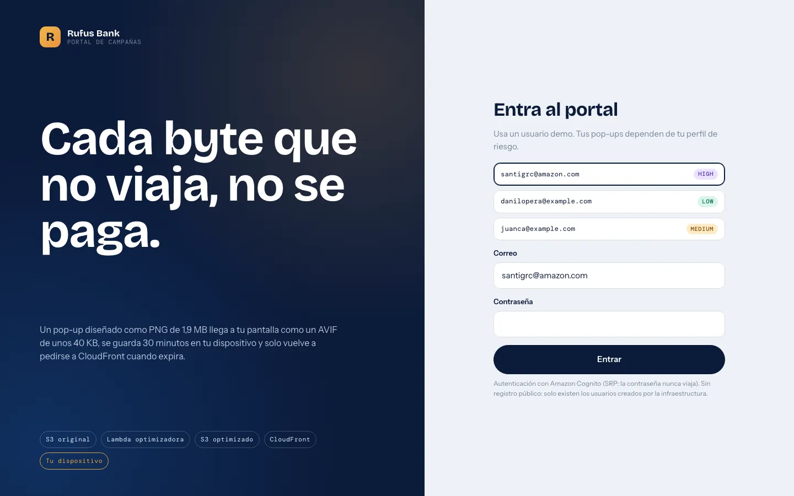 | Login con Cognito (SRP), sin registro público |
| 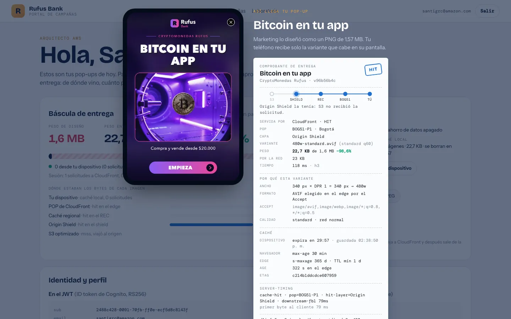 | El momento del caso: al entrar aparece el pop-up de la campaña de tu perfil, con su **comprobante de entrega**: AVIF 480w de 22,7 KB en lugar de un PNG de 1,57 MB |
| 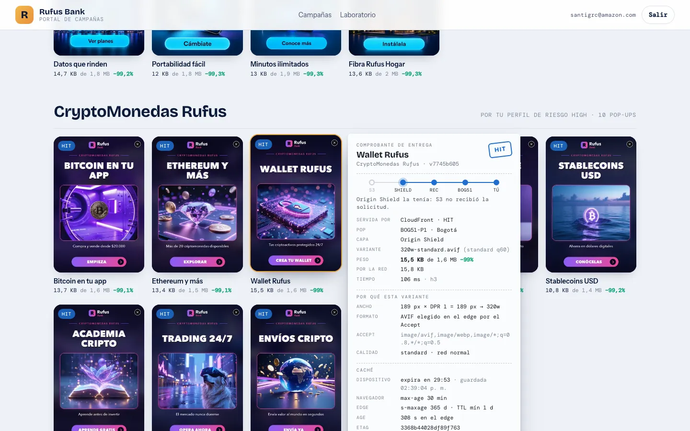 | Pasa el cursor (o toca) una imagen: ruta iluminada (S3, Shield, REC, POP, tú), POP y ciudad, variante, peso vs original, por qué esa variante (ancho × DPR, formato por `Accept`, calidad), Cache-Control, Age, ETag, Server-Timing y cuánto le queda en el dispositivo |
| 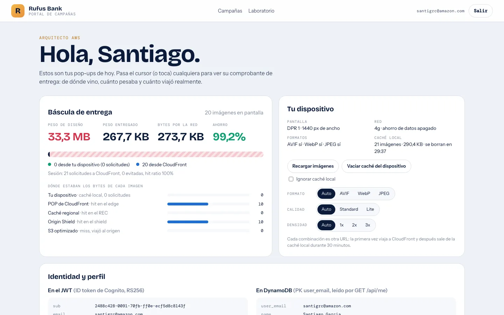 | Primera carga: 20 imágenes desde CloudFront (10 en el POP, 10 en Origin Shield, 0 en S3), 33,3 MB de diseño → 274 KB por la red |
| 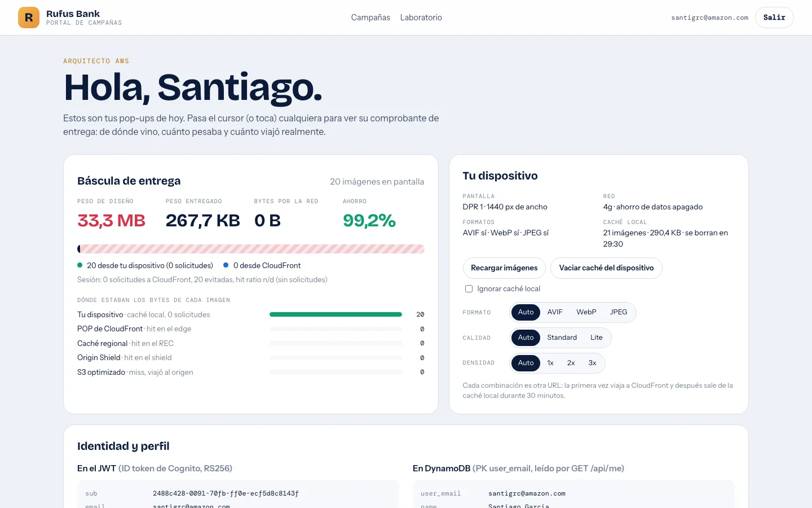 | Recarga: 20 de 20 desde el dispositivo, **0 solicitudes y 0 bytes** |
| 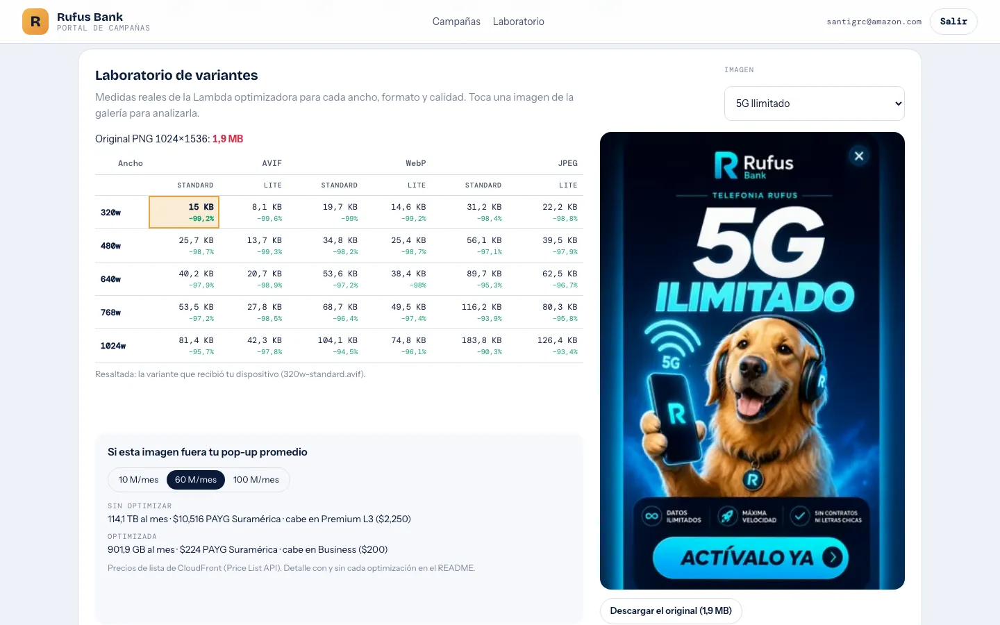 | Laboratorio: la matriz real de variantes de la Lambda, la que recibió tu dispositivo resaltada, el original para comparar y la proyección a 10 M, 60 M y 100 M al mes |

Controles del panel "Tu dispositivo": forzar formato (AVIF, WebP, JPEG), calidad (standard, lite) y densidad (1x, 2x, 3x), recargar imágenes, vaciar la caché local o ignorarla. Cada combinación es otra URL: la primera vez viaja a CloudFront y después sale del dispositivo.

## Costos: 10 M, 60 M y 100 M solicitudes, sin y con optimizaciones

Generado por `scripts/cost_model.py` (`make costs`) con precios de lista de la **AWS Price List API (2026-11-20)** y los tamaños **medidos** en las 40 imágenes, escalados al promedio de 1,5 MB del caso. El detalle completo, con supuestos, está en [`docs/COSTS.md`](docs/COSTS.md). Es un escenario, no una cotización.

Supuestos principales: 45% de los teléfonos piden 1024w, 35% 768w y 20% 640w; 85% acepta AVIF, 13% WebP y 2% solo JPEG; 15% de las solicitudes van en tier lite; la caché de 30 minutos evita 35% de las descargas y la URL versionada de 1 año evita 80%. Incluye WAF y CloudFront Functions en el PAYG; no descuenta el free tier.

### Peso por solicitud

| # | Escenario | KB por solicitud | vs. original |
|---|---|---:|---:|
| S0 | Sin optimización (PNG/JPG de 1,5 MB, cada apertura descarga de nuevo) | 1.536,0 | - |
| S1 | + Ancho del dispositivo (todavía JPEG q80) | 102,6 | −93,3% |
| S2 | + AVIF / WebP por `Accept` | 45,2 | −97,1% |
| S3 | + Calidad adaptativa (15% lite) | 42,5 | −97,2% |
| S4 | + Caché en el dispositivo 30 min (35% menos descargas) | 42,5 | −97,2% |
| S5 | Alternativa: URL versionada + 1 año `immutable` (80% menos descargas) | 42,5 | −97,2% |

### 60 M solicitudes al mes (el volumen del caso)

| # | Escenario | Solicitudes a CloudFront | Transferencia | PAYG Suramérica | PAYG US/EU (Price Class 100) | Plan flat-rate que alcanza |
|---|---|---:|---:|---:|---:|---|
| S0 | Sin optimización | 60,0 M | 85,83 TB | US$ 8.906 | US$ 6.454 | Premium L3 US$ 2.250 |
| S1 | + Ancho del dispositivo | 60,0 M | 5,74 TB | US$ 829 | US$ 610 | Business US$ 200 |
| S2 | + AVIF / WebP | 60,0 M | 2,53 TB | US$ 467 | US$ 331 | Business US$ 200 |
| S3 | + Calidad adaptativa | 60,0 M | 2,38 TB | US$ 450 | US$ 317 | Business US$ 200 |
| S4 | + Caché 30 min | 39,0 M | 1,54 TB | US$ 295 | US$ 209 | Business US$ 200 |
| S5 | Alternativa: 1 año immutable | 12,0 M | 486 GB | US$ 96 | US$ 70 | Business US$ 200 |

### 10 M solicitudes al mes

| # | Escenario | Solicitudes a CloudFront | Transferencia | PAYG Suramérica | PAYG US/EU (PC100) | Plan flat-rate |
|---|---|---:|---:|---:|---:|---|
| S0 | Sin optimización | 10,0 M | 14,31 TB | US$ 1.625 | US$ 1.247 | Business US$ 200 |
| S1 | + Ancho del dispositivo | 10,0 M | 979 GB | US$ 145 | US$ 108 | Business US$ 200 |
| S2 | + AVIF / WebP | 10,0 M | 431 GB | US$ 84 | US$ 62 | Business US$ 200 |
| S3 | + Calidad adaptativa | 10,0 M | 405 GB | US$ 82 | US$ 59 | Business US$ 200 |
| S4 | + Caché 30 min | 6,5 M | 264 GB | US$ 56 | US$ 41 | Business US$ 200 |
| S5 | Alternativa: 1 año immutable | 2,0 M | 81 GB | US$ 23 | US$ 18 | Business US$ 200 |

### 100 M solicitudes al mes

| # | Escenario | Solicitudes a CloudFront | Transferencia | PAYG Suramérica | PAYG US/EU (PC100) | Plan flat-rate |
|---|---|---:|---:|---:|---:|---|
| S0 | Sin optimización | 100,0 M | 143,05 TB | US$ 14.292 | US$ 10.034 | Premium L4 US$ 3.500 |
| S1 | + Ancho del dispositivo | 100,0 M | 9,56 TB | US$ 1.376 | US$ 1.011 | Business US$ 200 |
| S2 | + AVIF / WebP | 100,0 M | 4,21 TB | US$ 774 | US$ 546 | Business US$ 200 |
| S3 | + Calidad adaptativa | 100,0 M | 3,96 TB | US$ 745 | US$ 524 | Business US$ 200 |
| S4 | + Caché 30 min | 65,0 M | 2,57 TB | US$ 487 | US$ 343 | Business US$ 200 |
| S5 | Alternativa: 1 año immutable | 20,0 M | 811 GB | US$ 155 | US$ 111 | Business US$ 200 |

### Desglose a 60 M (Suramérica, pay-as-you-go)

| Concepto | S0 sin optimizar | S4 optimizado (30 min) | S5 optimizado (1 año) |
|---|---:|---:|---:|
| Data transfer out (por niveles) | US$ 8.729,36 | US$ 173,92 | US$ 53,51 |
| Solicitudes HTTPS (US$ 0,0220 por 10.000) | US$ 132,00 | US$ 85,80 | US$ 26,40 |
| CloudFront Functions (US$ 0,10 por millón, 2 M gratis) | US$ 0,00 | US$ 3,70 | US$ 1,00 |
| Origin Shield (solo misses, US$ 0,0075 por 10.000) | US$ 0,90 | US$ 0,58 | US$ 0,18 |
| AWS WAF (web ACL + reglas + solicitudes) | US$ 44,00 | US$ 31,40 | US$ 15,20 |
| **Total mensual** | **US$ 8.906,26** | **US$ 295,40** | **US$ 96,29** |

Lectura rápida:

- **El 98% de la factura sin optimizar es transferencia de datos.** Duplicar las solicitudes casi no mueve el total; duplicar los bytes lo duplica.
- **Solo redimensionar ya baja 93% los bytes** (y 91% la factura): es el primer paso, aunque todavía sea JPEG.
- Con todo optimizado, **pay-as-you-go y Business quedan cerca** (US$ 295 vs US$ 200 a 60 M) y con URL versionada de 1 año el PAYG (US$ 96) queda **por debajo** de Business. Optimiza primero y elige el modelo de precio con tus números medidos.

## Planes flat-rate: Business, Premium y Enterprise

Los planes existen desde noviembre de 2025 y se contratan **por distribución**. "Enterprise" en la práctica es **Premium configurable** o **precio custom** con el equipo de cuenta.

| Plan | US$ por mes | Solicitudes | Transferencia | Lo relevante para imágenes |
|---|---:|---:|---:|---|
| Pro | 15 | 10 M | 50 TB | Sin cache policies ni response headers personalizados: no sirve para este diseño |
| **Business** | **200** | **125 M** | **50 TB** | WAF y DDoS incluidos, logs a CloudWatch, 1 TB de créditos S3, políticas personalizadas, SLA. **Sin Origin Shield** |
| Premium | 1.000 | 500 M | 50 TB | Agrega Origin Shield y failover automático de origen |
| Premium configurable | 1.450 a 10.000 | 750 M a 6 B | 75 a 600 TB | L2 75 TB / 750 M US$ 1.450, L3 125 TB / 1,25 B US$ 2.250, L4 200 TB / 2 B US$ 3.500, L5 350 TB / 3,5 B US$ 6.000, L6 600 TB / 6 B US$ 10.000 |
| Custom (Enterprise) | consultar | sin límite | sin límite | Más de 6 B solicitudes o 600 TB, o acuerdos privados |

Dónde cae cada volumen:

| Volumen | Sin optimizar | Optimizado (S4) |
|---|---|---|
| 10 M | 14,3 TB: Business US$ 200 (vs PAYG US$ 1.625) | 264 GB: PAYG US$ 56 es más barato que Business |
| 60 M | 85,8 TB: no cabe en Business, **Premium L3 US$ 2.250** (vs PAYG US$ 8.906) | 1,5 TB: **Business US$ 200** (vs PAYG US$ 295) |
| 100 M | 143 TB: **Premium L4 US$ 3.500** (vs PAYG US$ 14.292) | 2,6 TB: **Business US$ 200** (vs PAYG US$ 487) |

Reglas que deciden (y que conviene revisar antes de firmar):

- Un **web ACL de WAF es obligatorio** y no se puede compartir con otras distribuciones; lo mismo para las CloudFront Functions asociadas.
- **No compatibles**: Shield Advanced, Firewall Manager sobre el web ACL, real-time logs, continuous deployment (staging), OAI, configuración legacy (`ForwardedValues`), WAF Rule Groups, distribuciones multi-tenant.
- **No se combinan con otros descuentos**: EDP/PPA, Savings Bundle ni promociones. Compara contra el PAYG ya descontado de la organización.
- Los límites son blandos: **sin cargos por exceso**; el primer pico hasta 3x se absorbe ese mes y el exceso sostenido (2 a 3 meses) puede degradar la entrega (menos POPs o más lejanos). Hay avisos al 50%, 80% y 100%.
- Lambda@Edge y las métricas adicionales de CloudWatch se cobran aparte; CloudFront Functions y la ingesta de logs estándar a CloudWatch están incluidas.
- En un plan no hay diferencia de precio por región: Price Class deja de ser una palanca de costo.

Este repositorio ya es compatible con un plan: OAC, cache policies modernas, sin real-time logs, WAF y Functions propios por distribución. Para Business solo hay que apagar Origin Shield (`origin_shield_enabled: false` en `cdk.json`).

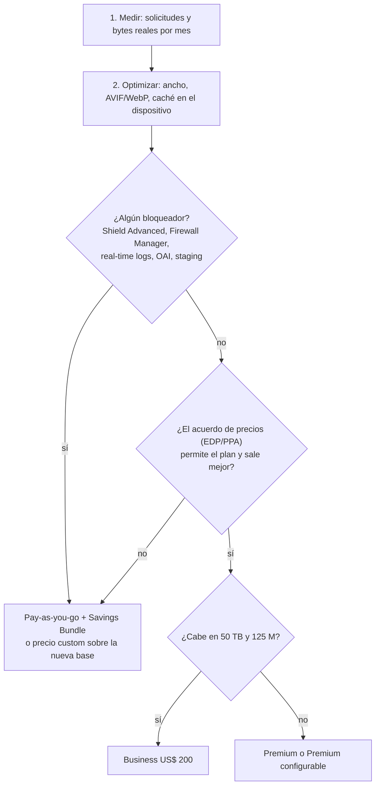

## Costos que no se ven a primera vista

| Costo | Cuándo aparece | Cómo se controla |
|---|---|---|
| Transferencia en cache HIT | Siempre: el byte entregado al teléfono se cobra aunque venga del edge | Menos bytes por imagen y menos descargas |
| Solicitudes HTTPS en Suramérica | US$ 0,0220 por 10.000, 2,2x la tarifa de US | Caché en el dispositivo; en flat-rate no se cobran aparte |
| Price Class | Price Class All usa el POP de Bogotá con tarifa SA (hasta 2x US en niveles altos) | Price Class 100/200 sirve desde US/EU: más barato y más lento |
| Cache busters en la URL | Tokens o timestamps cambian la URL en cada login | URLs estables y versionadas |
| Gzip/Brotli en imágenes | No reduce bytes y duplica entradas por `Accept-Encoding` | Cache policy de imágenes sin compresión |
| Invalidaciones | 1.000 rutas gratis al mes, luego US$ 0,005 por ruta | Nombres versionados |
| Lambda@Edge | US$ 0,60 por millón + cómputo, también en flat-rate | CloudFront Functions (US$ 0,10 por millón) |
| Real-time logs | US$ 0,01 por millón de líneas + Kinesis, y bloquean flat-rate | Standard logs v2 |
| Métricas adicionales | Precio fijo por métrica (8 por distribución) | Solo donde se necesita el CacheHitRate |
| WAF en PAYG | US$ 5 por ACL + US$ 1 por regla + US$ 0,60 por millón | Incluido en flat-rate |
| Descuentos que no suman | Flat-rate no se combina con EDP/PPA ni Savings Bundle | Comparar contra el PAYG descontado |
| Datos móviles del cliente | No está en la factura de AWS, pero un pop-up de 1,5 MB consume el plan del usuario | Las mismas optimizaciones: AVIF a 640-1024w pesa entre 2% y 5% del original |

Costos que sí son pequeños: S3 (183 MB para las 40 imágenes: 66 MB de originales y 117 MB de variantes en el bucket optimizado), la Lambda optimizadora (~5 s por imagen nueva a 3 GB, una sola vez), S3 GET desde CloudFront (solo misses del shield) y la transferencia S3 → CloudFront (gratis).

Costo de dejar esta demo encendida: principalmente los 2 web ACL de WAF (~US$ 17 al mes más solicitudes), Secrets Manager (US$ 0,40) y las métricas adicionales; el resto queda en centavos o en free tier. `make destroy` lo elimina todo.

## Despliegue paso a paso

Requisitos: cuenta AWS con CDK bootstrap en **us-east-1** (WAF para CloudFront y logs de CloudFront viven ahí), Node.js 22 o superior, Python 3.13 o superior, Poetry 2 y credenciales AWS activas.

```bash
cp .example.env .env          # completa DEMO_USERS_PASSWORD (y OPENAI_API_KEY si quieres regenerar imágenes)
make install                  # Poetry (.venv en la raíz) + layer de Pillow arm64 + npm ci
make test                     # 28 tests unitarios
make deploy                   # 3 stacks; la contraseña viaja como parámetro NoEcho
make e2e                      # 79 validaciones contra AWS (outputs/e2e-report.json)
make costs                    # regenera docs/COSTS.md con los tamaños medidos
make dev                      # portal local (Vite) apuntando al backend desplegado
make destroy                  # elimina todo
```

`make deploy` construye el portal, instala el layer de Pillow para Lambda arm64 sin Docker (pip con `--platform manylinux_2_28_aarch64`) y escribe `outputs/cdk-outputs.json` y `frontend/public/config.json` para desarrollo local.

Imágenes de la demo: `make images` las regenera con OpenAI (`gpt-image-2`). Durante la construcción la cuenta de OpenAI se quedó sin créditos después de 19 imágenes, así que las otras 21 se generaron con Amazon Bedrock (Stability AI Stable Image Ultra, arte sin texto) y `scripts/popup_composer.py` agregó marca, titular, subtítulo y botón con ortografía exacta: `python scripts/generate_images.py --provider bedrock`. El proveedor de cada imagen queda en su JSON (`generator`).

## Validación E2E

`scripts/e2e_test.py` resultado del despliegue: **79/79 PASS en 47 s**.

| Bloque | Qué valida |
|---|---|
| Seguridad (17) | Los 3 buckets bloquean acceso público, exigen TLS, no tienen website hosting y niegan GET anónimo (403); cero Lambda Function URLs; WAF y OAC en ambas distribuciones |
| Pipeline (2) | 40 imágenes `READY` en el catálogo y 1.240 objetos (31 por imagen) en el bucket optimizado |
| Cognito (14) | Self sign-up deshabilitado y `SignUp` rechazado; los 3 usuarios `CONFIRMED`, login sin cambio de contraseña, JWT sin datos de perfil, perfil mapeado en DynamoDB |
| API (16) | 401 sin token; cada perfil recibe Telefonía + su campaña (20 imágenes); datos desde DynamoDB; `private, no-store`; gzip |
| CDN (17) | AVIF/WebP/JPEG según `Accept`, `w=300&dpr=2` → 640w, `w=2000&dpr=3` → 1024w, `Save-Data` → lite, MISS → HIT en BOG51, Cache-Control, CORS, Timing-Allow-Origin, Server-Timing, `Vary`, 404 en rutas desconocidas y traversal, AVIF 640w 98,1% más liviano en promedio |
| Portal (13) | CSP, HSTS, X-Frame-Options, nosniff, Referrer-Policy, Permissions-Policy, `index.html` con `no-cache`, rutas SPA, `config.json`, JS `immutable` y comprimido con Brotli, errores reales en archivos inexistentes |

Validación en navegador (gstack `/browse`): login de los 3 perfiles (HIGH, LOW y MEDIUM con su segmentación), pop-up con comprobante, hover en la galería, recarga con 20/20 desde el dispositivo y 0 solicitudes de red, vista móvil y laboratorio. Esa prueba encontró y corrigió tres bugs: el `Accept: */*` de `fetch()` (el edge respondía JPEG), una detección de formatos bloqueada por la CSP y una carrera en el `onLoad` de las tarjetas.

## Medir antes de decidir

Consultas de **CloudWatch Logs Insights** sobre `/aws/vendedlogs/cloudfront/cloudfront-images-optimization-images-cdn-dev`:

```
# Hit ratio por tipo de resultado
fields `x-edge-result-type` as result
| stats count(*) as requests by result

# Bytes por formato (lo que se factura)
fields `sc-content-type` as type, `sc-bytes` as bytes
| stats count(*) as requests, sum(bytes) / 1048576 as MB, avg(bytes) / 1024 as avg_KB by type

# POP y país de los usuarios
fields `x-edge-location` as pop, `c-country` as country
| stats count(*) as requests by pop, country
| sort requests desc
```

Revisiones rápidas con curl:

```bash
CDN=https://<ImagesCdnUrl>
curl -sI "$CDN/img/telefonia-rufus/telefonia-rufus-01/<version>?w=640" -H "Accept: image/avif,image/webp,*/*" \
  | grep -iE "^(content-type|content-length|x-cache|x-amz-cf-pop|age|cache-control|server-timing|x-amz-meta-rufus-variant):"
```

En la cuenta real: el reporte de objetos populares (top 50, sin logs), las métricas `Requests` y `BytesDownloaded` (bytes por solicitud), y el CUR por `line_item_usage_type` para ver la región de cada byte.

## Decisiones y supuestos

| Decisión | Alternativa | Por qué en este repo |
|---|---|---|
| Variantes pre-generadas por evento S3 | Transformación bajo demanda (Dynamic Image Transformation for Amazon CloudFront, API Gateway + Lambda + Sharp) | Catálogo pequeño y curado; si se necesitan tamaños arbitrarios, usar la solución con firma de solicitudes y un origin group (S3 primero, API Gateway en 403/404), nunca Function URLs |
| Caché del dispositivo de 30 min | `max-age=31536000, immutable` (1 año) | 30 minutos fue el requisito de la demo; en producción, con URLs versionadas, 1 año es lo recomendado (escenario S5). Se cambia en `browser_max_age_seconds` |
| Price Class All | Price Class 100/200 | Muestra el POP de Bogotá. Con PC100 los mismos bytes cuestan ~28% menos pero llegan desde US/EU |
| Origin Shield encendido | Apagado | Demuestra la capa; en Business no está incluido |
| ID token en `GET /api/me` | Access token con scopes | El ID token trae el claim `email` que mapea el perfil; en producción, access token + claim personalizado |
| CORS `*` en imágenes | Lista de orígenes | Imágenes públicas sin credenciales; si fueran privadas, signed cookies y orígenes explícitos |
| WAF en ambas distribuciones | Sin WAF | Seguridad y requisito de los planes flat-rate (cuesta ~US$ 8 por ACL al mes en PAYG) |
| Secrets Manager con la llave administrada por AWS | KMS CMK + rotación | Contraseña fija de demo; en producción aplicar CMK dedicada y rotación |
| Rol "Data Architect" | "Data Arquitect" | Se corrigió la ortografía del rol del usuario demo |

## Estructura del proyecto

```
aws-cloudfront-images-optimization/
├── Makefile                        # orquestador: install, test, deploy, e2e, costs, dev, destroy
├── cdk.json                        # app_config (dev): anchos, formatos, calidades, TTLs, usuarios, WAF...
├── pyproject.toml / poetry.toml    # Poetry con .venv en la raíz
├── .example.env                    # referencia de .env (secretos locales, nunca versionado)
├── assets/
│   ├── architecture.drawio/.png    # diagrama de arquitectura (DPI 400)
│   ├── cache-layers.drawio/.png    # capas de caché
│   └── images/original/campaigns/  # 40 PNG (~1,7 MB) + JSON con título, CTA y generador
├── backend/lambdas/
│   ├── image_optimizer/            # S3 event -> variantes AVIF/WebP/JPEG + catálogo (Python, Pillow)
│   ├── profile_api/                # GET /api/me: perfil DynamoDB + segmentación por riesgo
│   └── users_seeder/               # custom resource: usuarios Cognito + perfiles DynamoDB
├── cloudfront/
│   ├── image-negotiation.js        # ancho x DPR, formato por Accept, calidad por Save-Data/ECT
│   └── spa-rewrite.js              # rutas SPA -> /index.html
├── docs/
│   ├── COSTS.md / costs.json       # modelo de costos generado
│   └── screenshots/                # capturas del portal (WebP)
├── frontend/                       # React 19 + Vite 8 + TypeScript + Amplify Auth
├── infrastructure/cdk/
│   ├── app.py
│   ├── helpers/                    # tags, rutas, WAF
│   └── stacks/                     # images, backend, frontend
├── lambda-layers/pillow/           # Makefile + requirements (Pillow 13 manylinux aarch64)
├── scripts/                        # generate_images, popup_composer, e2e_test, cost_model, diagrams, stack_outputs
└── tests/unit/                     # optimizador, CloudFront Function, API, aserciones CDK
```

## Referencias

- CloudFront: [cache key y cache policies](https://docs.aws.amazon.com/AmazonCloudFront/latest/DeveloperGuide/controlling-the-cache-key.html), [TTL y expiración](https://docs.aws.amazon.com/AmazonCloudFront/latest/DeveloperGuide/Expiration.html), [aumentar el hit ratio](https://docs.aws.amazon.com/AmazonCloudFront/latest/DeveloperGuide/cache-hit-ratio.html), [compresión](https://docs.aws.amazon.com/AmazonCloudFront/latest/DeveloperGuide/ServingCompressedFiles.html), [response headers policies y Server-Timing](https://docs.aws.amazon.com/AmazonCloudFront/latest/DeveloperGuide/understanding-response-headers-policies.html), [Origin Shield](https://docs.aws.amazon.com/AmazonCloudFront/latest/DeveloperGuide/origin-shield.html), [OAC](https://docs.aws.amazon.com/AmazonCloudFront/latest/DeveloperGuide/private-content-restricting-access-to-s3.html), [standard logging v2](https://docs.aws.amazon.com/AmazonCloudFront/latest/DeveloperGuide/standard-logging.html), [versionar en lugar de invalidar](https://docs.aws.amazon.com/AmazonCloudFront/latest/DeveloperGuide/UpdatingExistingObjects.html)
- Precios: [pay-as-you-go](https://aws.amazon.com/cloudfront/pricing/pay-as-you-go/), [planes flat-rate](https://docs.aws.amazon.com/AmazonCloudFront/latest/DeveloperGuide/flat-rate-pricing-plan.html), [FAQ de CloudFront](https://aws.amazon.com/cloudfront/faqs/)
- Imágenes: [blog de optimización de imágenes con CloudFront y Lambda](https://aws.amazon.com/blogs/networking-and-content-delivery/image-optimization-using-amazon-cloudfront-and-aws-lambda/), [Dynamic Image Transformation for Amazon CloudFront](https://docs.aws.amazon.com/solutions/latest/dynamic-image-transformation-for-amazon-cloudfront/), [WebP](https://developers.google.com/speed/webp), [AVIF](https://web.dev/articles/compress-images-avif)
- Clientes móviles: [caché de OkHttp](https://github.com/square/okhttp/blob/master/docs/features/caching.md), [red en Coil 3](https://coil-kt.github.io/coil/network/), [RFC 8246 `immutable`](https://www.rfc-editor.org/rfc/rfc8246)

# LICENSE

Copyright 2026 Santiago Garcia Arango

Licensed under the Apache License, Version 2.0 (the "License"); you may not use this file except in compliance with the License. You may obtain a copy of the License at

    http://www.apache.org/licenses/LICENSE-2.0

Unless required by applicable law or agreed to in writing, software distributed under the License is distributed on an "AS IS" BASIS, WITHOUT WARRANTIES OR CONDITIONS OF ANY KIND, either express or implied. See the License for the specific language governing permissions and limitations under the License. The full text is in [LICENSE](LICENSE).
